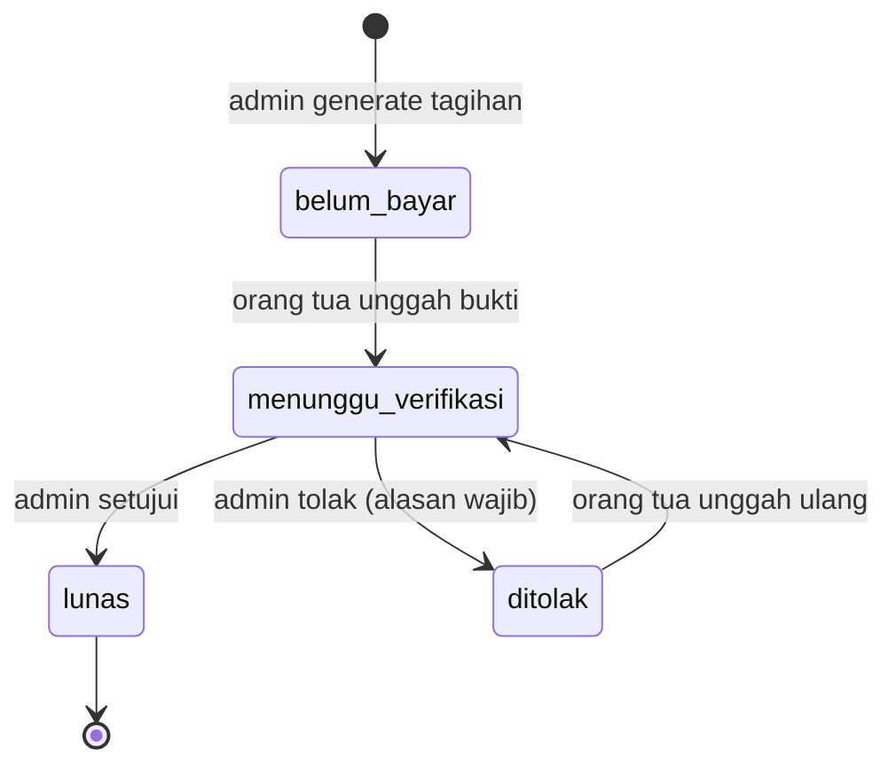

# ERD dan Aturan Data — SKMS

Keputusan pemilik D1–D5 ditetapkan pada 14 Oktober 2026 di `docs/DECISIONS.md`. Bagian skema menjelaskan migration yang ada; bagian aturan menjelaskan kontrak target yang belum seluruhnya diterapkan. Status implementasi ada di `docs/TASKS.md`.

Basis data: MySQL. Konvensi: nama tabel jamak snake_case, primary key `id` (bigint unsigned), `created_at` dan `updated_at` di semua tabel, uang dalam **integer rupiah** (bukan float), foreign key ketat dengan `ON DELETE RESTRICT` kecuali disebut lain. Peran pengguna memakai tabel spatie/laravel-permission (`roles`, `permissions`, `model_has_roles`, dan seterusnya) dengan 4 role: `admin`, `guru`, `kepala_sekolah`, `orang_tua`.

## 1. Diagram

```mermaid
erDiagram
    USERS ||--o| TEACHERS : "profil guru"
    USERS ||--o| GUARDIANS : "profil orang tua"
    ACADEMIC_YEARS ||--o{ CLASSROOMS : "memiliki"
    TEACHERS ||--o{ CLASSROOMS : "wali kelas"
    CLASSROOMS ||--o{ CLASSROOM_TEACHER : "memiliki guru"
    TEACHERS ||--o{ CLASSROOM_TEACHER : "ditugaskan ke"
    CLASSROOMS ||--o{ ENROLLMENTS : "berisi"
    STUDENTS ||--o{ ENROLLMENTS : "terdaftar"
    ACADEMIC_YEARS ||--o{ ENROLLMENTS : "tahun ajaran"
    GUARDIANS ||--o{ GUARDIAN_STUDENT : "wali dari"
    STUDENTS ||--o{ GUARDIAN_STUDENT : "punya wali"
    STUDENTS ||--o{ INVOICES : "ditagih"
    ACADEMIC_YEARS ||--o{ INVOICES : "periode"
    INVOICES ||--o{ PAYMENTS : "pengajuan bukti"
    USERS ||--o{ PAYMENTS : "diunggah oleh"
    USERS ||--o{ PAYMENTS : "ditinjau oleh"
    INVOICES ||--o| CASH_LEDGER_ENTRIES : "dicatat saat lunas"
    PAYMENTS ||--o| CASH_LEDGER_ENTRIES : "bukti pendukung"
    STUDENTS ||--o{ DAILY_JOURNALS : "dinilai"
    TEACHERS ||--o{ DAILY_JOURNALS : "ditulis oleh"
    DAILY_JOURNALS ||--|{ JOURNAL_ASSESSMENTS : "5 aspek"
    STUDENTS ||--o{ ANECDOTAL_NOTES : "diamati"
    TEACHERS ||--o{ ANECDOTAL_NOTES : "ditulis oleh"
    CLASSROOMS ||--o{ ANNOUNCEMENTS : "target opsional"
    USERS ||--o{ ANNOUNCEMENTS : "dibuat oleh"
    USERS ||--o{ AUDIT_LOGS : "pelaku"

    USERS {
        bigint id PK
        string name
        string email UK
        string password
        boolean must_change_password
        boolean is_active
        timestamp last_login_at
    }
    TEACHERS {
        bigint id PK
        bigint user_id FK
        string name
        string nip UK
        string phone
    }
    GUARDIANS {
        bigint id PK
        bigint user_id FK
        string name
        string phone
        text address
    }
    ACADEMIC_YEARS {
        bigint id PK
        string name UK
        date start_date
        date end_date
        boolean is_active
    }
    CLASSROOMS {
        bigint id PK
        bigint academic_year_id FK
        bigint homeroom_teacher_id FK
        string name
        enum level_A_B_nullable
        string age_range
    }
    CLASSROOM_TEACHER {
        bigint id PK
        bigint classroom_id FK
        bigint teacher_id FK
        string role
        timestamp created_at
        timestamp updated_at
    }
    STUDENTS {
        bigint id PK
        string nis UK
        string name
        date birth_date
        string gender
        unsignedSmallInteger entry_year
        string status
    }
    ENROLLMENTS {
        bigint id PK
        bigint student_id FK
        bigint classroom_id FK
        bigint academic_year_id FK
        string status
    }
    GUARDIAN_STUDENT {
        bigint id PK
        bigint guardian_id FK
        bigint student_id FK
        string relationship
        boolean is_primary
    }
    INVOICES {
        bigint id PK
        string invoice_number UK
        bigint student_id FK
        bigint academic_year_id FK
        tinyint period_month
        smallint period_year
        bigint amount
        bigint discount_amount
        date due_date
        string status
        timestamp paid_at
        bigint verified_by FK
        timestamp verified_at
    }
    PAYMENTS {
        bigint id PK
        bigint invoice_id FK
        bigint submitted_by FK
        string proof_path
        bigint amount_transferred
        date transfer_date
        string sender_name
        text note
        string status
        bigint reviewed_by FK
        timestamp reviewed_at
        text rejection_reason
    }
    CASH_LEDGER_ENTRIES {
        bigint id PK
        bigint invoice_id FK
        bigint payment_id FK
        date entry_date
        string description
        bigint amount_in
        string receipt_number UK
    }
    DAILY_JOURNALS {
        bigint id PK
        bigint student_id FK
        bigint classroom_id FK
        bigint teacher_id FK
        date journal_date
        string activity_summary
        string status
        timestamp finalized_at
    }
    JOURNAL_ASSESSMENTS {
        bigint id PK
        bigint daily_journal_id FK
        string aspect
        string level
        text note
    }
    ANECDOTAL_NOTES {
        bigint id PK
        bigint student_id FK
        bigint teacher_id FK
        datetime noted_at
        text observed_behavior
        text interpretation
        text follow_up
        string photo_path
    }
    ANNOUNCEMENTS {
        bigint id PK
        bigint created_by FK
        bigint classroom_id FK
        enum target_level (A, B) nullable
        string title
        text body
        boolean is_pinned
        string status
        timestamp published_at
        timestamp expires_at
    }
    AUDIT_LOGS {
        bigint id PK
        bigint user_id FK
        string action
        string entity_type
        bigint entity_id
        json old_values
        json new_values
        timestamp created_at
    }
```

Tabel pendukung tanpa relasi di diagram: `school_settings` (`id` bigint unsigned PK, `key` string UNIQUE, `value` text nullable, timestamps), serta tabel bawaan Laravel (`password_reset_tokens`, `sessions`, `cache`, `cache_locks`, `jobs`, `job_batches`, `failed_jobs`) dan tabel Spatie. Key settings meliputi `school_name`, `school_address`, `school_phone`, `bank_name`, `bank_account_number`, `bank_account_holder`, `default_spp_amount`, tanggal awal/akhir semester, serta `school_holidays` (D3: JSON daftar tanggal di kolom text yang ada, bukan kolom baru; belum diisi oleh seeder sekarang).

Skema domain aktual merupakan gabungan empat migration berikut, ditambah migration users/Spatie/Laravel:

| Migration | Isi nyata |
|---|---|
| `2026_10_06_000100_create_skms_tables.php` | Tabel domain dasar, `students.entry_year` unsignedSmallInteger, constraint dan indeks |
| `2026_10_06_000200_add_receipt_number.php` | `cash_ledger_entries.receipt_number` string wajib UNIQUE |
| `2026_10_08_000300_create_classroom_teacher_table.php` | Pivot guru kelas, role string default `pendamping`, UNIQUE kelas/guru, dua FK CASCADE; wali lama dibackfill ke pivot sebagai `wali_kelas` |
| `2026_10_13_000100_add_class_levels_and_announcement_targets.php` | `classrooms.level` dan `announcements.target_level`, enum A/B nullable; backfill tingkat kelas yang dikenal |

Diagram tidak menampilkan semua default/nullable/index; rincian aktual di bagian 7. Aturan maksimal tiga guru dan satu sasaran pengumuman ditegakkan aplikasi, bukan CHECK atau batas jumlah baris migration.

## 2. Nilai enum

| Kolom | Nilai |
|---|---|
| `students.status` | `aktif`, `nonaktif` |
| `students.gender` | `L`, `P` |
| `enrollments.status` | `aktif`, `pindah`, `selesai` |
| `guardian_student.relationship` | `ayah`, `ibu`, `wali` |
| `invoices.status` | `belum_bayar`, `menunggu_verifikasi`, `lunas`, `ditolak` |
| `payments.status` | `menunggu`, `disetujui`, `ditolak` |
| `daily_journals.status` | `draf`, `final` |
| `journal_assessments.aspect` | `nilai_agama_moral`, `fisik_motorik`, `kognitif`, `bahasa`, `sosial_emosional` |
| `journal_assessments.level` | `BB` (belum berkembang), `MB` (mulai berkembang), `BSH` (berkembang sesuai harapan), `BSB` (berkembang sangat baik) |
| `announcements.status` | `draf`, `terbit` |
| `classrooms.level` | `A`, `B`, atau NULL |
| `announcements.target_level` | `A`, `B`, atau NULL |

`classroom_teacher.role` adalah **string**, bukan enum database. Nilai aplikasi adalah `wali_kelas` dan `pendamping`, default migration `pendamping`.

## 3. Constraint dan indeks penting

- `invoices`: UNIQUE (`student_id`, `period_month`, `period_year`); nominal akhir = `amount - discount_amount`; indeks pada `status`, `due_date`.
- `enrollments`: UNIQUE (`student_id`, `academic_year_id`). Kelas siswa pada tahun ajaran aktif ditentukan dari tabel ini, sehingga kenaikan kelompok tidak menghapus riwayat.
- `classrooms`: UNIQUE (`academic_year_id`, `name`) dan UNIQUE (`academic_year_id`, `homeroom_teacher_id`); wali kelas nullable. Satu guru menjadi wali paling banyak satu kelas per tahun ajaran.
- `classroom_teacher`: UNIQUE (`classroom_id`, `teacher_id`); FK ke kelas dan guru memakai ON DELETE CASCADE. Maksimal tiga guru per kelas (satu wali, hingga dua pendamping) adalah aturan aplikasi D1. Tahun ajaran berasal dari kelas, tidak ada kolom tahun ajaran pada pivot.
- `classrooms.level` memakai enum `A|B` nullable pada skema nyata; kelas demo A-1/A-2 memiliki tingkat A, B-1/B-2 tingkat B. Rentang usia A 4–5 dan B 5–6 tahun; `display_name` adalah atribut model `Kelompok {name}`, bukan kolom migration.
- `announcements`: tepat satu target dapat dipilih: `classroom_id`, `target_level`, atau keduanya kosong untuk semua orang tua.
- `guardian_student`: UNIQUE (`guardian_id`, `student_id`). Seorang siswa memiliki minimal satu wali.
- `daily_journals`: UNIQUE (`student_id`, `journal_date`).
- `journal_assessments`: UNIQUE (`daily_journal_id`, `aspect`). Jurnal final wajib memiliki kelima aspek.
- `cash_ledger_entries`: UNIQUE (`invoice_id`) dan UNIQUE (`receipt_number`); entri hanya dibuat oleh sistem dan tidak dapat diubah atau dihapus lewat UI. Kolom `payment_id` merupakan FK ke bukti pembayaran yang disetujui. Nomor kuitansi berformat `KWT/YYYY/MM/NNN`.
- `audit_logs`: Menggunakan kolom `created_at` saja tanpa `updated_at` karena bersifat catatan log audit kejadian yang tidak dapat diubah (append-only).
- `users.email` UNIQUE; `teachers.nip` UNIQUE; `students.nis` UNIQUE (format `2425-014`); `invoices.invoice_number` UNIQUE (format `INV-2026-10-071`).

## 4. State machine status tagihan



Aturan transisi (diterapkan di `PaymentVerificationService`):
1. Hanya `belum_bayar` dan `ditolak` yang dapat menerima unggahan bukti. Setiap unggahan membuat satu baris `payments` berstatus `menunggu`.
2. Hanya `admin` yang dapat menyetujui atau menolak, dan hanya untuk pembayaran `menunggu`.
3. **Setuju:** `payments.status = disetujui`, `invoices.status = lunas`, isi `paid_at`, `verified_by`, `verified_at`, dan buat satu `cash_ledger_entries` (`amount_in` = nominal akhir tagihan), semuanya dalam satu transaksi database.
4. **Tolak:** `payments.status = ditolak` dengan `rejection_reason`, `invoices.status = ditolak`.
5. `lunas` bersifat final: tidak ada transisi keluar, nominal tidak dapat diubah.
6. Setiap transisi dicatat di `audit_logs`.
7. Label "terlambat N hari" ditampilkan bila `due_date` lewat dan status bukan `lunas` (dihitung, tidak disimpan).

## 5. Aturan bisnis data

- **Akun otomatis:** saat admin membuat guru atau orang tua baru, sistem membuat `users` (role sesuai), kata sandi sementara acak, `must_change_password = true`. Kata sandi ditampilkan sekali. Untuk kakak-adik, `guardians` yang sudah ada dipilih ulang, bukan dibuat baru.
- **Hak akses data (D1):** orang tua hanya siswa terkait `guardian_student`; wali kelas dan pendamping yang ditugaskan pada kelas boleh membaca/menulis jurnal dan anekdot siswa dengan enrollment aktif di kelas itu pada tahun ajaran aktif. Maksimal satu wali dan dua pendamping. Kepala sekolah hanya baca; admin jurnal/anekdot hanya baca.
- **Jendela edit jurnal:** jurnal `final` dapat diubah guru pembuatnya sampai akhir hari berikutnya (konfigurabel), lalu terkunci. Pesan UI contoh: "Jurnal sudah disimpan, bisa diubah sampai 2 Okt 2026."
- **Nonaktif, bukan hapus:** siswa, guru, dan orang tua tidak dihapus bila sudah punya transaksi atau jurnal; gunakan status nonaktif.
- **Ganti wali kelas (D1):** hapus penugasan/pivot guru lama dari kelas itu sehingga seluruh akses baca/tulis dicabut. Tidak otomatis menjadi pendamping; admin boleh menugaskannya sebagai pendamping melalui aksi terpisah. `daily_journals.teacher_id` dan `anecdotal_notes.teacher_id` tetap menunjuk penulis lama; ia tidak dapat mengubahnya setelah dilepas.
- **Nominal SPP:** default dari `school_settings.default_spp_amount`, dapat diubah per tagihan sebelum lunas (diskon dicatat di `discount_amount`).
- **Tunggakan >30 hari (D2):** status `belum_bayar` atau `ditolak`, dengan `due_date < hari_ini - 30 hari` (Asia/Jakarta). Pending/lunas tidak termasuk. PDF dan Excel memakai query/filter yang sama dengan layar. Aturan ini berbeda dari label keterlambatan umum di bagian 4.
- **Keterisian jurnal (D3):** jumlah jurnal final / (hari sekolah × siswa aktif kelas). Kalender Senin–Jumat dikurangi tanggal JSON `school_settings.school_holidays`; bulan berjalan hanya sampai hari ini. Jangan memakai jumlah hari yang sudah diisi sebagai penyebut; kesempatan nol ditampilkan 0%.
- **Tren siswa (D4):** siswa unik dengan enrollment aktif yang dibuat sebelum akhir bulan, pada tahun ajaran terpilih, dan siswa sekarang masih aktif. Status nonaktif sekarang mengeluarkan siswa dari titik bulan terdahulu; bukan rekonstruksi histori. Tidak ada kolom baru.
- **Data publik (D5):** nama, telepon, alamat sekolah boleh menjadi shared props tamu; bank tidak. Bank/default SPP hanya diberikan kepada role terautentikasi yang memerlukannya.

## 6. Data demo (seeder)

Target seeder agar dashboard terlihat nyata dan konsisten antar layar:
- `SchoolSettingsSeeder` mengisi identitas sekolah, alamat, telepon, rekening, default SPP, rentang semester, dan `school_holidays` sebagai JSON. Seeder jurnal memakai helper kalender yang sama dengan laporan; Oktober 2026 memiliki 22 hari kerja dikurangi lima tanggal libur yang dikonfigurasi sehingga 17 hari sekolah. Jumlah ini berasal dari konfigurasi, bukan asumsi tetap.
- 1 tahun ajaran aktif 2026/2027 (dan 2025/2026 untuk riwayat), 4 kelas (A-1, A-2, B-1, B-2) dengan pembagian 20, 19, 20, 19 siswa, 78 siswa aktif, sekitar 64 orang tua (beberapa punya dua anak), 12 guru dan staf, 1 admin, 1 kepala sekolah.
- Tagihan Okt 2026 untuk 78 siswa: 63 lunas, 9 menunggu verifikasi (siswa 64–72), 6 belum bayar (siswa 73–78).
- Tagihan Sep 2026 untuk 78 siswa: 69 lunas, 3 ditolak dengan alasan realistis (siswa 64–66), 6 belum bayar (siswa 73–78, menunggak >30 hari).
- Tagihan Agu 2026 untuk 78 siswa: 75 lunas, 3 belum bayar (siswa 76–78).
- Diskon saudara kandung (`discount_amount = 50000`) diterapkan pada siswa 1 dan 65 yang berbagi akun orang tua sama (`guardians[0]`).
- Seeder jurnal memakai `SchoolCalendarService` dan key `school_holidays`; persentase dihitung dari tanggal sekolah yang dikonfigurasi, bukan konstanta jumlah hari.
- Pengumuman mencakup sasaran semua orang tua, tingkat A, tingkat B, kelas A-2, kedaluwarsa, dan draf.
- Akun demo: `admin@skms.test`, `guru@skms.test`, `kepsek@skms.test`, `ortu@skms.test` (kata sandi demo di README, bukan di repo publik).
- **Catatan:** angka pada mockup (misalnya 61 transaksi, Rp 21.350.000) hanya ilustrasi dan tidak perlu sama persis dengan seeder.

## 7. Rincian tipe, nullable, foreign key, dan indeks aktual

Setiap tabel domain memakai `id` bigint unsigned PK dan timestamps, kecuali `audit_logs` yang hanya memakai `created_at` timestamp default CURRENT_TIMESTAMP. `string` adalah varchar(255) kecuali disebut lain; semua field wajib kecuali ditandai nullable. Semua foreign ID domain adalah bigint unsigned dengan RESTRICT, **kecuali** dua FK pivot `classroom_teacher` yang CASCADE. Indeks otomatis FK/UNIQUE mengikuti migration.

| Tabel | Kolom dan default nyata selain id/timestamps | Constraint/indeks tambahan |
|---|---|---|
| users | name/email/password string; email_verified_at timestamp nullable; must_change_password boolean false; is_active boolean true; last_login_at timestamp nullable; remember_token string(100) nullable | email UNIQUE; is_active INDEX |
| school_settings | key string; value text nullable | key UNIQUE |
| academic_years | name string; start_date/end_date date; is_active boolean false | name UNIQUE; is_active INDEX |
| teachers | user_id FK users; name/nip/phone string | user_id UNIQUE; nip UNIQUE |
| guardians | user_id FK users; name/phone string; address text | user_id UNIQUE |
| classrooms | academic_year_id FK; homeroom_teacher_id FK teachers nullable; name/age_range string; level enum A/B nullable | UNIQUE (academic_year_id,name), (academic_year_id,homeroom_teacher_id) |
| classroom_teacher | classroom_id FK; teacher_id FK; role string default pendamping | kedua FK CASCADE; UNIQUE (classroom_id,teacher_id) |
| students | nis/name string; birth_date date; gender enum L/P; entry_year unsignedSmallInteger; status enum aktif/nonaktif default aktif | nis UNIQUE; status INDEX |
| enrollments | student_id/classroom_id/academic_year_id FK; status enum aktif/pindah/selesai default aktif | UNIQUE (student_id,academic_year_id); status INDEX |
| guardian_student | guardian_id/student_id FK; relationship enum ayah/ibu/wali; is_primary boolean false | UNIQUE (guardian_id,student_id) |
| invoices | invoice_number string; student_id/academic_year_id FK; period_month unsignedTinyInteger; period_year unsignedSmallInteger; amount/discount_amount unsignedBigInteger (discount default 0); due_date date; status enum empat status default belum_bayar; paid_at/verified_at timestamp nullable; verified_by FK users nullable | invoice_number UNIQUE; UNIQUE (student_id,period_month,period_year); status/due_date INDEX |
| payments | invoice_id/submitted_by FK (submitted_by users); proof_path/sender_name string; amount_transferred unsignedBigInteger; transfer_date date; note/rejection_reason text nullable; status enum menunggu/disetujui/ditolak default menunggu; reviewed_by FK users nullable; reviewed_at timestamp nullable | status INDEX |
| cash_ledger_entries | invoice_id/payment_id FK; entry_date date; description/receipt_number string; amount_in unsignedBigInteger | invoice_id UNIQUE; receipt_number UNIQUE; payment_id bukan UNIQUE |
| daily_journals | student_id/classroom_id/teacher_id FK; journal_date date; activity_summary string; status enum draf/final default draf; finalized_at timestamp nullable | UNIQUE (student_id,journal_date); status INDEX |
| journal_assessments | daily_journal_id FK; aspect dan level enum bagian 2; note text nullable | UNIQUE (daily_journal_id,aspect) |
| anecdotal_notes | student_id/teacher_id FK; noted_at datetime; observed_behavior/interpretation/follow_up text wajib; photo_path string nullable | tidak ada UNIQUE tambahan |
| announcements | created_by FK users; classroom_id FK nullable; target_level enum A/B nullable; title string; body text; is_pinned boolean false; status enum draf/terbit default draf; published_at/expires_at timestamp nullable | status INDEX |
| audit_logs | user_id FK; action/entity_type string; entity_id unsignedBigInteger; old_values/new_values JSON nullable; created_at timestamp default CURRENT_TIMESTAMP | INDEX (entity_type,entity_id); tanpa updated_at |

Kolom sessions.user_id pada migration Laravel hanya foreignId nullable + index tanpa constraint FK. Role/permission aplikasi berada di migration Spatie; `classroom_teacher.role` adalah penugasan kelas, berbeda dari role login `guru`. `school_holidays` adalah baris key/value target baru pada tabel settings yang ada; dokumentasi tidak menyatakan seeder/query sekarang sudah mendukungnya.
